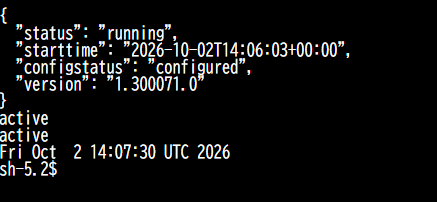
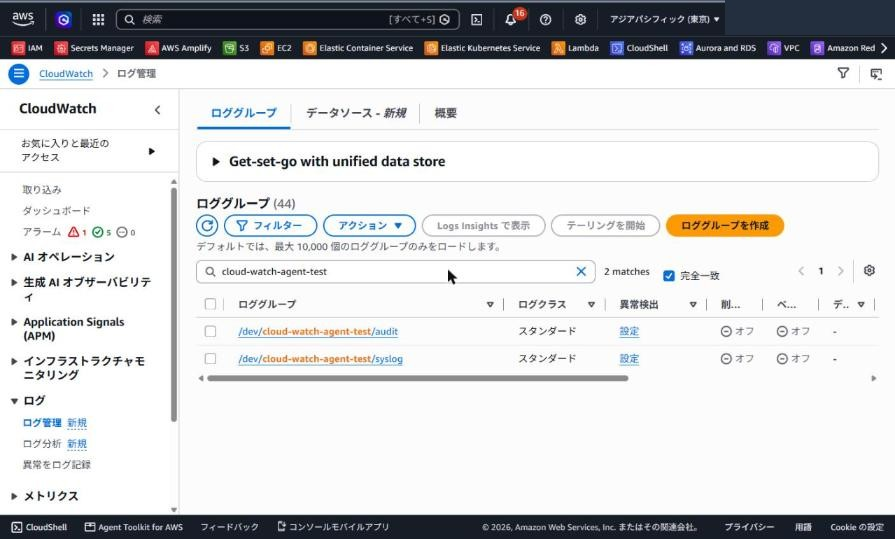
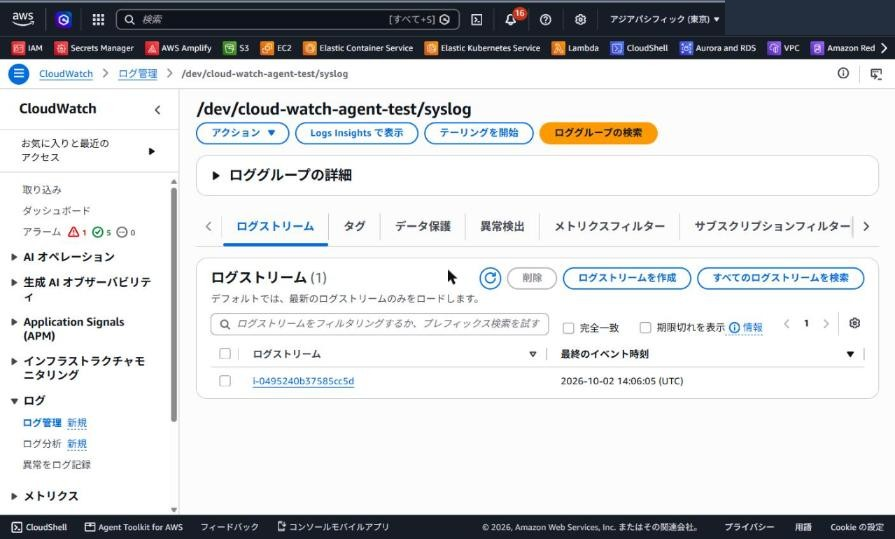
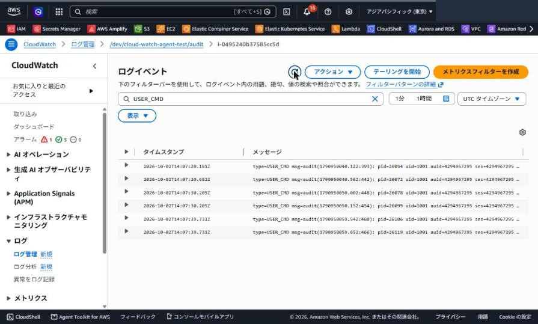

## はじめに

実務で触る機会があったのでEC2 に CloudWatch エージェントを入れて、syslog と audit ログを CloudWatch Logs に転送する構成を Terraform で作ってみました。

クラウド環境ではあまりOSレイヤのログをとったりすることは少ないのですが、セキュリティポリシーで定められている場合必要になることがあります。

OS は Amazon Linux 2023（AL2023）で、ネットワークは別リポジトリで作った共通 VPC を remote state で参照します。
インスタンスはプライベートサブネットに置き、インバウンドは開けずに Session Manager で入ります。

## CloudWatch エージェントとは

EC2 やオンプレのサーバーに入れて、OS のログファイルやメトリクスを CloudWatch に送るエージェントです。
どのファイルをどのロググループに送るかは JSON の設定ファイルで決め、`fetch-config` で取り込んでから起動します。

## やってみる

### 1. 共通 VPC を remote state で参照する

自分はVPCは別のTerraformで管理しているのでVPC 側の state をremote_state読み、VPC ID とプライベートサブネットの ID を取り出します。

```hcl
data "terraform_remote_state" "cmn_vpc" {
  backend = "s3"

  config = {
    bucket = "<STATE_BUCKET>"
    key    = "cmn-vpc/terraform.tfstate"
    region = "ap-northeast-1"
  }
}

locals {
  vpc_id    = data.terraform_remote_state.cmn_vpc.outputs.vpc.cmn_vpc.id
  subnet_id = data.terraform_remote_state.cmn_vpc.outputs.vpc.cmn_vpc_priv_subnet_ids[0]
}
```

VPC のTerraform側で `output` していれば上記のようにremote_stateで参照できます。

### 2. ロググループを作る

ロググループは自分で管理したいので、保持期間付きで Terraform に定義します。
定義しなくてもCloudWatch エージェントによって自動作成されますが、`destroy` でまとめて消せるようにしたいためです。

```hcl
resource "aws_cloudwatch_log_group" "syslog" {
  name              = "/${var.env}/${var.service_name}/syslog"
  retention_in_days = var.log_retention_in_days
}

resource "aws_cloudwatch_log_group" "audit" {
  name              = "/${var.env}/${var.service_name}/audit"
  retention_in_days = var.log_retention_in_days
}
```

### 3. IAM ロールを付ける

管理ポリシーを2つ付けておきます。実際の運用では最小権限を付与しておいたほうがいいでしょう。

```hcl
resource "aws_iam_role_policy_attachment" "ssm_core" {
  role       = aws_iam_role.ec2.name
  policy_arn = "arn:aws:iam::aws:policy/AmazonSSMManagedInstanceCore"
}

resource "aws_iam_role_policy_attachment" "cloudwatch_agent" {
  role       = aws_iam_role.ec2.name
  policy_arn = "arn:aws:iam::aws:policy/CloudWatchAgentServerPolicy"
}
```

`AmazonSSMManagedInstanceCore` は Session Manager でEC2にログインする用途、`CloudWatchAgentServerPolicy` はエージェントがログを送る用途です。

### 4. user_data で設定ファイルを書いてエージェントを起動する

エージェントの設定は user_data にヒアドキュメントで直書きします。
ロググループ名は `templatefile` でリソースから渡し、Terraform 側の名前とずれないようにしています。

```hcl
user_data = templatefile("${path.module}/user_data.sh.tftpl", {
  syslog_log_group_name = aws_cloudwatch_log_group.syslog.name
  audit_log_group_name  = aws_cloudwatch_log_group.audit.name
})
user_data_replace_on_change = true
```

AL2023 は既定だと journald だけで `/var/log/messages` が無いので、rsyslog も一緒に入れます。
`audit.log` は root しか読めない権限なので、エージェントは root で動かします。

```bash
dnf install -y rsyslog amazon-cloudwatch-agent
systemctl enable --now rsyslog
systemctl enable --now auditd

cat > /opt/aws/amazon-cloudwatch-agent/etc/amazon-cloudwatch-agent.json <<'CONFIG'
{
  "agent": { "run_as_user": "root" },
  "logs": { "logs_collected": { "files": { "collect_list": [
    { "file_path": "/var/log/messages", "log_group_name": "${syslog_log_group_name}", "log_stream_name": "{instance_id}" },
    { "file_path": "/var/log/audit/audit.log", "log_group_name": "${audit_log_group_name}", "log_stream_name": "{instance_id}" }
  ] } } }
}
CONFIG

/opt/aws/amazon-cloudwatch-agent/bin/amazon-cloudwatch-agent-ctl   -a fetch-config -m ec2 -s   -c file:/opt/aws/amazon-cloudwatch-agent/etc/amazon-cloudwatch-agent.json
```

- `${...}` は Terraform が値を埋めこみます。
- `{instance_id}` は実際の設定ファイルにも{instance_id}が入り、エージェントがインスタンス ID に置き換えます。

### 5. インスタンスの中でエージェントを確認する

EC2 の「接続」から Session Manager で入り、書き出した設定ファイルとエージェントの状態を見ます。

```bash
sudo cat /opt/aws/amazon-cloudwatch-agent/etc/amazon-cloudwatch-agent.json
sudo /opt/aws/amazon-cloudwatch-agent/bin/amazon-cloudwatch-agent-ctl -a status
# "status": "running"
systemctl is-active rsyslog auditd
```



### 6. CloudWatch Logs に届いたか確認する

テスト用に syslog へ1行書き、sudo で audit のイベントを出します。

```bash
logger "cwagent-test syslog check"
sudo ls /root
```

CloudWatch のロググループに syslog と audit の2つができ、ストリーム名はインスタンス ID になっています。





audit 側は `USER_CMD` で絞ると、sudo の実行が届いているのが見えます。



## まとめ

- CloudWatch エージェントの導入から syslog / audit ログの転送までをやってみました。
